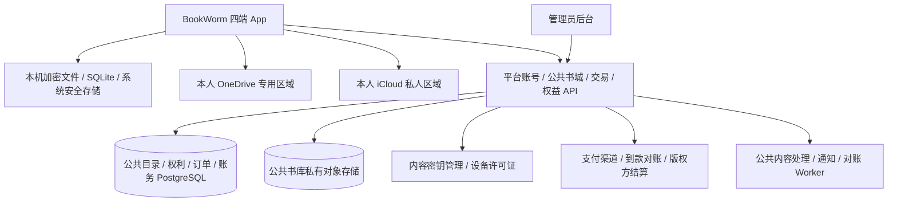
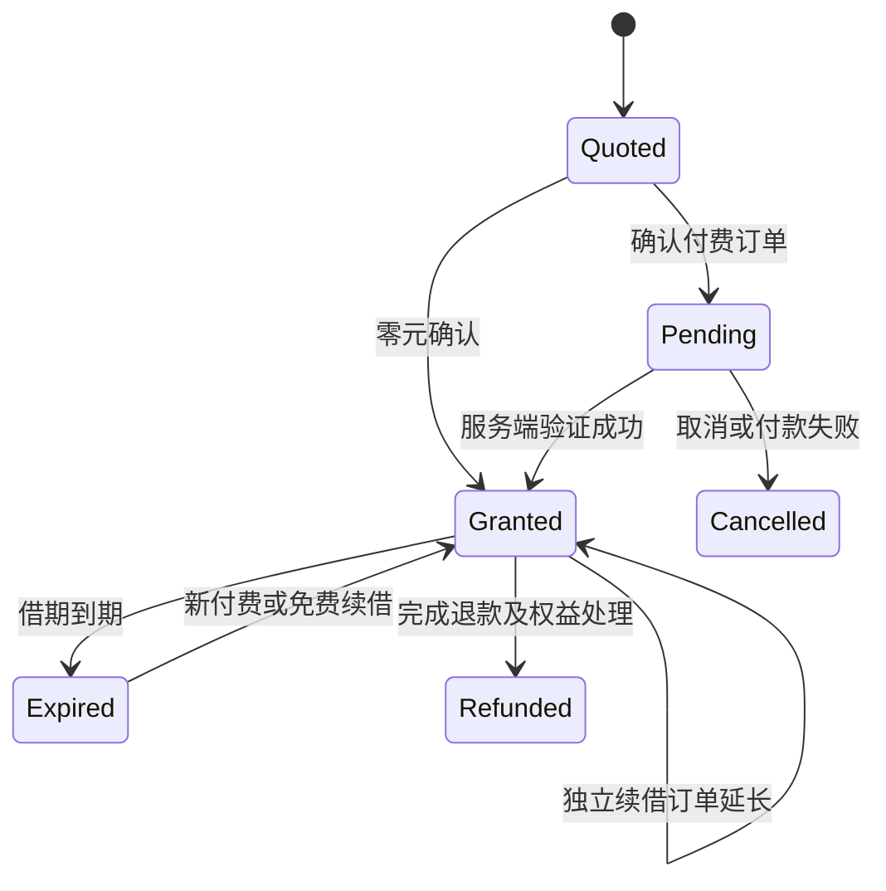

> 历史草案：0.2 商业远景已暂缓。当前以同目录 0.3 文档为准，不执行这里的加密、公共书库或交易要求。

# BookWorm／书虫：系统设计文档

版本：0.2（已纳入用户修订，整体方案待确认）
日期：2026-11-14（America/Detroit）
需求依据：[产品需求 0.2](requirements.md) · [确认清单](review.md)

## 1. 架构变化与实施状态

本版取代 0.1 的库存型借阅、平台私人书库存储、平台进度同步、默认在线阅读及公共评论设计。目标为：**私人内容与进度直连个人云；公共内容由管理员发布；版权按书借阅或购买，默认加密离线；净收入平台 5%／版权方 95%。**

本轮只更新文档，不改 App 功能。现有工程仍为旧名本地原型，尚未实现加密、私人云、订单、权益、分成或服务端；以前的 macOS Debug 构建及两项基础测试不构成 0.2 验收。已下载的 EPUB／PDF、SQLite 等依赖尚未接入。未发布的 Sites 遗留配置不作为生产架构。

## 2. 三个独立的数据域

图中个人云与平台 API 不建立私人正文或阅读进度的中转线路。公共书库“私有对象存储”是平台受控源站，不是用户的私人云。

### 2.1 数据位置矩阵

| 数据 | 本机 | 本人 OneDrive／iCloud | 平台后端 |
| --- | --- | --- | --- |
| 私人原书、封面、私人目录与书名 | 加密管理，原始导入源另属用户 | 用户启用后加密同步 | 不接收，包括明文／密文、私人哈希与书目列表 |
| 私人／公共书的个人读听进度与历史 | 保存 | 用户启用后端到端加密同步 | 不接收 |
| 个人划线、笔记、书签 | 保存 | 用户可选加密同步 | 不接收 |
| 个人评论、点评、评分 | 仅本机保存 | 不同步 | 不接收，不生成聚合评分 |
| 私人 TTS／检索／OCR 产物 | 加密保存或内存处理 | 必要时按私人库策略保存 | 不接收，不调用平台处理正文 |
| 私人云授权令牌与解密密钥 | 系统安全存储 | 仅存加密的恢复／设备封装信息 | 不接收 |
| 公开书目、权利材料、定价与公共内容包 | 已获得版本的本地缓存 | 可选保存不包含明文密钥的受控包 | 由管理员录入和管理 |
| 账号、设备授权、公钥、交易、已购／借阅权益 | 必要缓存 | 权益可作加密备份，不能作为授予凭证 | 权威数据来源 |
| 支付、税费、渠道费、分成及结算 | 本人订单展示 | 无需进入私人库 | 保存可审计账务 |

删除书虫账号与删除用户云中的文件是两件事；提供分别选择和执行结果，不能把“账号已注销”误报为所有 OneDrive／iCloud 副本已删除。断开云授权不删除本地书，不把未同步状态覆盖成空库。

## 3. 技术栈与组件边界（建议）

| 组件 | 建议设计 |
| --- | --- |
| 四端 App | Flutter／Dart；原生插件或 platform channel 承担文件、媒体、系统安全存储和云连接 |
| 本地 | SQLite 元数据及 outbox；正文与资源为加密分块包；敏感元数据使用成熟加密数据库或字段加密，不能仅因位于沙箱就视为已加密 |
| 个人云 | `PrivateCloudProvider` 接口；OneDrive 与 iCloud 两个连接器；客户端直连，不携带平台应用级全库权限 |
| 平台服务 | FastAPI 模块化单体、PostgreSQL、Redis、独立 Worker；提供公共目录、身份、支付、权益和管理功能 |
| 平台文件 | S3 兼容对象存储隔离区、审核原件、加密发布包；KMS／密钥服务单独权限 |
| 管理后台 | 内部 Web 应用，RBAC＋MFA；公共入库、定价、版权方、订单、财务与审计 |
| 外部适配 | 支付、邮件／推送；公共书籍 AI／OCR／语音服务按权限和预算配置，私人内容默认本地处理 |

应用名称统一 BookWorm／书虫；应用 ID、包名、反向域名和商店名称可用性在实施前确定，不能从通用名称推定商标或商店标识已取得。

建议目录：`app/`、`domain/`、`data/local/`、`data/private_cloud/`、`data/platform_api/`、`features/reader/`、`features/tts/`、`features/library/`、`features/store/`、`features/transactions/`、`services/crypto/`、`services/sync/`、`platform/`。私人云模型与平台 API DTO 不共用“上传整库”的接口。

## 4. OneDrive 与 iCloud 接入

### 4.1 公共连接器接口

提供授权、账户检查、读写对象、分页枚举变化、上传大对象、取消、重试、空间检查和撤权处理。文件级协议不依赖云厂商提供数据库事务。

每个私人库具有随机 `library_id` 和自己的密钥，不把平台 user_id、电子邮箱或可读书名放进云路径。云登录身份不等于平台购书身份；在私人库中复制一份订单文件不能生成交易权益。

### 4.2 OneDrive

使用 Microsoft Graph 用户委托授权，原生 App 采用适合公开客户端的授权流程，不内置 client secret；优先最小作用域 `Files.ReadWrite.AppFolder` 与本人专用区域。权限、个人／组织账户支持及管理员策略需在实际注册应用中验证，不自动扩大到读取全部云盘。

微软文档说明应用专用区域受云空间配额影响，且用户可修改或删除其中内容；因此设计必须容忍缺失、替换和配额不足，而不能把云盘当作不可变可信数据库。[OneDrive 应用专用区域](https://learn.microsoft.com/en-us/graph/onedrive-sharepoint-appfolder)

上传采用可恢复分片与校验，遵守服务端重试提示；令牌仅在本机安全存储。首批必测个人 OneDrive；组织账号的策略差异单列兼容结果，不以文档中的权限名称代替接入验收。

### 4.3 iCloud：明确区分 CloudKit 与 iCloud Drive

建议优先验证 **CloudKit 私人数据库／资产** 作为统一 iCloud 同步后端：iOS／macOS 使用原生 CloudKit，Android／Windows 验证 Apple 用户授权的 Web Services／CloudKit JS 路径，所有端指向同一 container 与私人库。这里的“私人”指用户自己的 private database，不使用 public database 存私人书。

Apple 的 Web Services 文档区分用户 API token＋Web Auth Token 路径与 server-to-server 的公共数据库路径。不能用后者在平台服务器上替代用户授权；文档存在不等于四端授权、后台续期和大资产传输已验证成功。[Apple CloudKit Web Services](https://developer.apple.com/library/archive/documentation/DataManagement/Conceptual/CloudKitWebServicesReference/SettingUpWebServices.html)

专项技术验证必须覆盖：Apple 开发者 container 与 entitlement、生产环境、Apple 登录／同意、Android 与 Windows 安全回调及 token 生命周期、大文件、网络恢复、用户私有配额、账号变更、后台限制与撤权。若使用官方网页授权页，页面不得向平台回传令牌或私人内容；回调参数不得写入访问日志，使用受支持的本地安全交接方式。

iCloud Drive 同步文件夹可作为苹果设备／Windows 的另一个传输方案，但与 CloudKit 不是同一文件空间，不能混用或假设 Android 原生支持。若用户要求必须是可在“文件”App 中看到的 iCloud Drive 书库，需单独确认并验证。iCloud 四端互通为首批验收目标，技术验证失败报告阻塞，不擅自降级为只支持苹果端。

### 4.4 主云与迁移

每个书库先选一个主云，OneDrive 与 iCloud 使用相同逻辑包格式。切换时冻结短暂写入、复制密文和操作日志、校验清单、合并待发操作，再切换主库指针；保留原库直到用户确认。默认不运行跨云双主镜像。

## 5. 私人同步协议与读听坐标

### 5.1 不依赖平台中央游标

每台授权设备产生不可变操作日志，使用 `device_id + local_sequence + operation_id` 去重，携带因果版本／已见事件向量；云只保存端到端加密对象与提交清单。每次提交先写内容块，再写校验过的 manifest，最后发布 commit 标识；接收端缺任何引用块则等待，不能把半个包显示为可读。

各设备只追加自身日志，避免多个设备同时覆盖一个全局 JSON。云 change token 仅用于加速发现，失效时通过快照和日志重新对账；不把任一设备时间当作全局真相。兼容最终一致、重复交付、文件夹延迟、账号断开和随机缺块。

笔记并发修改保留两版，删除使用墓碑；建议保留 90 天，超期设备强制重新对账，不能使删除复活。评论／点评表不加入同步 schema 或 outbox；仅靠 UI 不显示同步按钮不足以满足“只本地”。

### 5.2 统一读听定位

位置结构：`edition_fingerprint, content_structure_version, chapter_id, paragraph_id, sentence_id, unicode_offset, mode, device_id, event_id`；PDF 补充页码与归一化坐标。偏移统一约定 Unicode 计数并转换到各渲染器，避免中文、emoji 与 UTF-16 产生错位。

保存最近有效位置、最远位置和各设备未合并位置。阅读转听书按句边界开始；TTS 回调将实际已播放字符映射回同一锚点，暂停／来电及时落盘。听转读定位到同句。语速／音色变化不使用旧秒数作位置；多端并发时展示来源和读听模式供选择。

进度在本地事件提交后异步上云，失败可离线继续；应用后台同步受 OS 限制，不承诺设备关机时仍实时上传。打开／恢复 App 时拉取新事件并给出续接建议。

## 6. 加密文件、密钥与离线许可证

### 6.1 威胁模型

目标：普通用户不能从缓存、云包、临时文件、备份、索引或 TTS 产物取得可直接分发的版权明文电子书；复制密文到另一账号／设备不获得解密权；个人云服务不持有私人库明文密钥。

限制：App 为渲染和 TTS 必须在受控运行环境中取得部分明文，不能保证抵抗已破解系统、调试器／内存抓取、录屏或拍照。第三方 DRM 文件不破解；权利方要求特定 DRM 时需独立四端 SDK 验证。参考 [OWASP 安全存储要求](https://mas.owasp.org/MASVS/controls/MASVS-STORAGE-1/)建立检查项，不自创密码算法。

### 6.2 容器格式与私人数据信任

- 使用成熟 AEAD 算法及库，例如 AES-256-GCM；每个对象独立数据密钥，分块 nonce 保证在同密钥下不重复；AAD 绑定包 ID、版本、块序号和格式版本，防替换、截断和重排。
- 清单和敏感元数据同样认证／加密；本机全文索引、封面、解密临时内容和生成语音也受保护，日志不记录正文。
- 私人库主密钥由客户端生成，数据密钥被主密钥封装；主密钥只保存在系统安全存储、经批准设备封装或恢复密钥加密的包中。平台不托管私人明文密钥。
- 新设备通过已有可信设备批准或用户恢复码解锁同一个私人库；仅登录 OneDrive／Apple 账号不足以让平台找回端到端加密密钥。丢失所有设备与恢复码会导致无法恢复，需在初始化时说明并引导安全备份。
- 密钥轮换使用新版本，设备撤销后停止发新包密钥；已经取得的离线私人内容不能被平台远程物理抹除。

### 6.3 平台版权内容密钥

管理员处理的版权版本在平台隔离环境转换、加密发布。出版版本内容密钥由服务端 KMS 保护，客户端仅获得绑定账户、设备和权益的许可证／封装密钥；不能直接沿用“私人库主密钥”把版权包变成可任意解锁的个人资产。

许可证包含 `license_id, entitlement_id, user_id, device_key_id, edition_id, package_hash, capabilities, issued_at, not_before, expires_at?, key_version, policy_version`，服务端签名，客户端校验。设备私钥不可作为普通文件备份，优先使用系统硬件支持的不可导出能力，平台实际差异需验证。

版权包可备份到本人云但不携带可复用明文密钥；新设备必须向平台验证借阅／购买权益并取得本设备许可证。复制云包不能绕过订单验证。公共销售许可到期与用户已购权益期限是不同字段，不把停止售卖自动变成撤销所有已购离线书。

### 6.4 离线、到期与自动下载

权益生效即创建自动下载任务，断点、空间和网络设置可控；下载齐备、校验哈希和许可证后才显示“离线可用”。内容先到而支付未确认时不能解密。

借阅许可证的 `expires_at` 不超过已付借期；续借完成重新签发，不限次数。客户端读取、翻页和分段 TTS 前检查有效期，长会话到期时停止后续解密。不要把解密后的完整书或长寿命全书密钥放在无到期约束的公共云文件中。

到期判断使用可信服务端时间锚点＋单调时钟，持久化最后可信时间，检测回拨。设备重启／时钟异常无法证明仍有效时要求联网恢复。断网撤销与退款有不可消除的延迟，需要确认最长离线验证窗口；不得因此退回“版权书默认不支持离线”的旧方案。

购买建议长期许可证或合理周期的离线验证策略，具体期限待用户确认；不能在未确认前强制所有已购书每 24 小时联网。普通客户端到期控制不是保证对抗破解设备的 DRM。

公版 App 缓存默认加密，但提供独立免费通用格式导出。用户导入时的原始文件不被擅自删除或改写，系统不能声称已使用户原先持有的明文不可访问。

## 7. 平台领域模型：移除库存，加入交易与分成

| 实体 | 核心字段／约束 |
| --- | --- |
| users / sessions / devices | 身份、会话、设备公钥、撤销；不保存私人云 token 或私人书库清单 |
| roles / audit_logs | 管理员职责、授权范围、敏感操作；公共上架仅管理员 |
| rightsholders / contracts | 版权方、权利链、收款资料引用、地区、服务能力、合同与审核状态 |
| works / editions / public_assets | 作品、具体版本、管理员录入、公开书目、受控原件／加密包哈希 |
| rights_records | 公版证据／版权授权、地区、有效期、TTS／借阅／购买／离线范围；不存数字副本数 |
| offers / offer_versions | 首借／续借／购买、币种、含税口径、期限、价格（可为 0）、报价有效期、条款版本 |
| orders / order_lines | 用户、报价快照、操作类型、金额、状态、幂等键；金额使用币种最小单位整数 |
| payments / payment_events | 渠道、唯一交易 ID、回调事件 ID、验证状态、实收、税费、实际渠道费、结算状态 |
| entitlements | 用户、版本、借阅／购买、起止、来源订单、状态；不依赖私人云客户端传入的“已买”字段 |
| renewals / entitlement_events | 每次续借与独立订单、旧新到期、价格快照；无次数上限 |
| device_licenses | 权益、设备、内容包、失效策略和签名版本；不包含私人书籍或阅读位置 |
| ledger_transactions / ledger_entries | 不可变平衡账本、币种、业务引用、计量／舍入策略、版权方应付、平台份额与冲正 |
| settlements / payouts | 版权方、结算范围、可付余额、渠道记录、打款状态、幂等键及失败重试 |
| refunds / disputes | 原订单、退款金额、退还税费、不可退费用、权益处理、账务冲正与争议状态 |
| notifications / outbox / jobs | 交易、借期、公共内容和系统事件；去重、可重试、无私人进度负载 |

明确删除：`loan_slots`、副本库存、借阅本数配额、预约／保留队列、续借次数上限、平台 `annotations/positions/reviews/comments` 数据表与写入接口。个人数据对应本机／私人云模型，不迁移进平台数据库。

## 8. 借阅、续借、购买与支付一致性

### 8.1 报价与发权

服务端报价固定版本、操作、币种、税费口径、时长、条款和价格。订单创建绑定用户及幂等键；旧报价失效需重新确认，不能静默换价。支付信息提交服务端验证，未验证为 pending；免费交易同样走可审计的零元权益流程，但不调用支付渠道。

外部支付与数据库无法原子提交，采用状态机和 outbox：订单待付 → 渠道处理中 → 已验证付款 → 权益及账务事件提交 → 下载／许可证通知。渠道成功而本地失败由对账恢复，同一渠道交易最多兑现一次；付款成功但上架授权失效时走人工／自动补偿，不无限停留“成功但无法使用”。

### 8.2 无库存事务

首次借阅只校验用户、有效商品、地区、报价与付款／免费确认，不检查可借数量。不锁用户“5 本配额”或抢最后一个 slot；所有合法用户可以同时获得同版借阅。

续借事务锁定同一用户版本的权益链，按订单事件只延长一次，建议 `new_expiry = max(current_expiry, activation_time) + duration`。不同明确确认的续借订单串行累加，重复回调不再次延长；续借次数无上限。当前报价为免费也不能跳过订单去重。

购买只创建／恢复本人持有权益；重复购买同版本应先提示已有购买，避免同一权益重复收费。借转买的抵扣与新版覆盖等待业务政策，不自行生成优惠或扣费。

实际订单、付款、借阅、购买分别建状态机；图仅表示用户权益主流程，不允许用一个状态字段替代多实体一致性。

### 8.3 恢复与跨端

四端用同一平台身份拉取交易权益，按发行渠道验证原始收据／订单；不得把任何云同步 manifest 中的价格或购买标记当作可信发权依据。新设备取包与申请许可证不收取已购书第二次书价。私人云负责读听位置，平台负责版权访问权，两条链独立恢复。

## 9. 净收入分成、账本与结算

### 9.1 确定公式

`分成基数 N = 实际收入 - 对应税费 - 对应渠道费`；`平台份额 P = round(N × 5%)`；`版权方份额 R = N - P`。金额按币种最小单位计算，舍入政策版本写入流水。仅在 `N >= 0` 且对应金额已确认时直接适用；负值进入异常处理，不默认负额出款。

在字段上明确“实收是否含税”，使税额只扣一次；渠道报表给出净到款时不得再次扣相同渠道费。示例总额 100、税费 10、渠道费 20 → N=70 → P=3.50、R=66.50。

### 9.2 预估与最终结算分开

支付成功不等于税费、渠道费已最终确定。先登记实收／应收与待结算记录，依据实际报告结算可分配净额；允许暂估显示但明确不可提现，差额以新调整分录校正。平台服务费 5% 不代表支付或应用商店抽成 5%。

每笔分录引用订单、支付／结算事件、版权方、币种和费用类型；同事件唯一入账。使用平衡账本，把付款、税费、渠道费、平台份额、版权方应付和出款分别记录，不以修改一列“余额”替代审计。不同币种不可直接相加。

### 9.3 退款、争议与出款

退款／拒付以原交易关联冲正，分别处理退还税、退还渠道费、不可退费用和已付版权方余额。部分退款的分摊、费用承担、结算保留期、最低出款额、结算周期、汇兑及多权利方拆分待确认；未经确认不默认从某方余额扣额或跨币种抵扣。

可结算金额与已打款状态分开；结算任务有业务键，外部成功／本地超时需查渠道结果再重试，禁止重复打款。版权方报表展示收入、税费、渠道费、分成基数、5%／95%、退款调整、结算中与已付款。

具体税务责任与支付分发由主体、地区和渠道决定，需业务确认；本设计不替代财务或法律意见。实施前核对 [Apple 数字内容审核规则](https://developer.apple.com/app-store/review/guidelines/)及 [Google Play 支付政策](https://support.google.com/googleplay/android-developer/answer/9858738)，不默认全端可跳转同一外部收银台。

## 10. 阅读器、TTS 与本机评论

格式适配器统一目录、定位、检索、渲染和可读文本提取；EPUB 结构化排版与 PDF 原页渲染分别实现。加密包按章节／页解密，避免整书明文落盘；对需要文件路径的第三方渲染器专项评估临时文件泄露，不满足保护要求则更换适配器或明确阻塞。

TTS 服务与页面解耦，分句／段队列、字符回调、定时、焦点、媒体键与中断状态机独立。私人书籍无会员校验；基础使用设备语音，不发平台正文请求。系统语音不可用时解释安装语音资源／文本层问题，而不是提示付费解锁。系统可能使用网络语音的行为需提供本机离线音色选项与隐私说明。

真人音频模块、音轨交易及上传全部不做本期实现；TTS 派生缓存只是本人朗读数据，仍加密，不作为可分享音频下载。

评论／点评／评分为独立本机表，不属于云备份清单、同步 outbox、平台 API、分析事件或推荐特征；对相应本地文件设置平台支持的系统云备份排除标记并验证，避免经 App 自动备份流出本机。划线笔记与点评分别分类，不能因为都叫“笔记”而误上传本地点评。

## 11. 公共内容管理、搜索与安全

只有管理员能提交公共文件、核查版权或公版、配置版权方报价、批准并发布。普通用户和版权方接口无上架写权限，即使构造请求也拒绝。版权方提供材料和定价不等于获得后台发布角色。

公共上传走隔离区、真实类型校验、病毒与结构检查、解压／XML／资源上限、无特权 Worker、安全 EPUB 解析和审计。公共平台处理流程与私人本机解析流程分开，私人文件不可被“上传失败重试”转发平台。

搜索只索引公共已发布内容，详情不返回公开点评、评分或私人读者名单。推荐以编辑书单、标签和用户主动兴趣为主；阅读排行榜／社交暂待范围确认，不从私人云抓取数据补足。

账号采用成熟密码哈希、短期 access token、refresh 轮换和撤销；管理员 MFA、职责分离。私人云令牌与内容密钥仅系统安全存储；设备授权防重放、日志脱敏和越权测试覆盖各角色。平台不能用客服排查为理由默认收集用户整库。

## 12. API 与本机接口草案

平台 `/v1`：统一请求 ID、结构化错误、分页和幂等键。内容包是密文，发权是签名许可证；不提供版权明文原件接口。

| 接口域 | 用途 |
| --- | --- |
| /auth /me /devices | 平台身份、会话、设备授权、账号删除；不返回私人云 token |
| /catalog /editions /offers | 公共书目、版本、免费／借／买／续报价 |
| /orders /payments /receipts | 订单、验证、恢复；服务端核验渠道凭证 |
| /entitlements /renewals | 有效权益、无限次数续借、归还／到期状态 |
| /packages /device-licenses | 密文包下载、设备绑定许可证、续期；不含个人进度 |
| /public-domain-downloads | 公版免费通用格式下载；不强制生成付费订单 |
| /refunds /support | 售后申请、状态、工单 |
| /admin/ingestion /rights /pricing | 仅管理员入库、权利核查、定价、发布／下架 |
| /admin/accounting /settlements | 对账、分成、出款与审计，独立财务权限 |
| /notifications | 平台交易和系统消息，无公开评论／预约消息 |

不提供平台 `/private-uploads`、`/positions`、`/annotations`、`/reviews`、`/comments`、`/reservations` 或库存分配接口。私人云连接、同步、评论均为客户端服务；云 HTTP 请求直接到相应用户授权服务。

## 13. 故障恢复、运维与四端交付

- 私人云：授权失效、容量不足、缺块、被用户删除、修改冲突均可恢复；无云不影响已缓存且权益有效内容；平台不承诺能代用户恢复丢失的端到端密钥。
- 支付：重复／乱序回调、未收到回调、退款先于付款本地落地均靠渠道状态核验与事件去重；不能在数据库恢复后重发全部版权方出款。
- 到期：在线请求实时校验，离线按许可证；Worker 停机不能让到期在线内容继续发权。
- 备份：平台仅备公共目录、交易、财务与授权；用户库备份和密钥恢复单列说明。数据库恢复演练核对账本及渠道交易。
- 性能：正文下载以密文对象存储分发为主，许可证 API 独立扩容；私人云同步不经过平台中转。Redis 不作为交易和权益唯一数据来源。
- 发布：生产／预发布隔离、密钥托管、兼容迁移、构建来源与依赖许可证清单、灰度和可回滚版本；公开发布与付费服务购买按实际授权执行。
- iOS／macOS 在 macOS＋Xcode 签名构建；Android 使用 SDK／JDK；Windows 使用 Windows 节点。四端均需真机／真实系统验证云连接、密钥、媒体控制与升级；不以一个 macOS 包冒充四端完成。

## 14. 必测用例与发布门槛

| 模块 | 验收重点 |
| --- | --- |
| 私人边界 | 私人书籍导入、TTS、同步抓包：只有本机／本人云；平台数据库、遥测、日志均无正文、书目或进度 |
| 云连接 | OneDrive／iCloud × 四端；同一私人库取回、token 续期／撤销、缺块、配额、回滚和云迁移；iCloud 非苹果端失败不得标绿 |
| 评论 | 写点评后读听、同步、崩溃上报、备份检查：点评只本机，平台无写入端点 |
| 读听协调 | 同句切换、跨音色／语速、PDF 文本层、中文／emoji、回放重读、多端并发与离线合并 |
| 无限借阅 | 多用户同时借同版、单人多本、连续多次续借，均不因库存／次数拒绝；同请求仅一笔交易 |
| 免费路径 | 公版全程无支付；版权方零价借／续正常发权且不调用付款；私人 TTS 不检查会员 |
| 收费 | 首借／续借／购买快照、验证、恢复、重复回调、到期转购买和退款／拒付状态 |
| 分成 | 净额税费只扣一次、0 元、最小单位舍入、实际费用校正、部分退款、负净额、已出款后退款和重复出款防护 |
| 加密离线 | 全部资源、索引、TTS 临时文件、云包无版权明文；跨账号复制、篡改、借期到期、回拨、设备重启、密钥恢复 |
| 格式与播放 | EPUB 图文脚注、PDF 扫描／加密／损坏、长书；后台 30 分钟、两小时连续 TTS、耳机／来电／蓝牙和睡眠 |
| 上架 | 普通读者／版权方直接调用发布失败；只有管理员核查的公版或版权方授权版本可见 |

所有验收关联需求编号与证据；关键隐私、计费、分成、到期或加密用例未通过不得标为商用。剩余决策见确认清单，用户确认前不继续功能实现。
