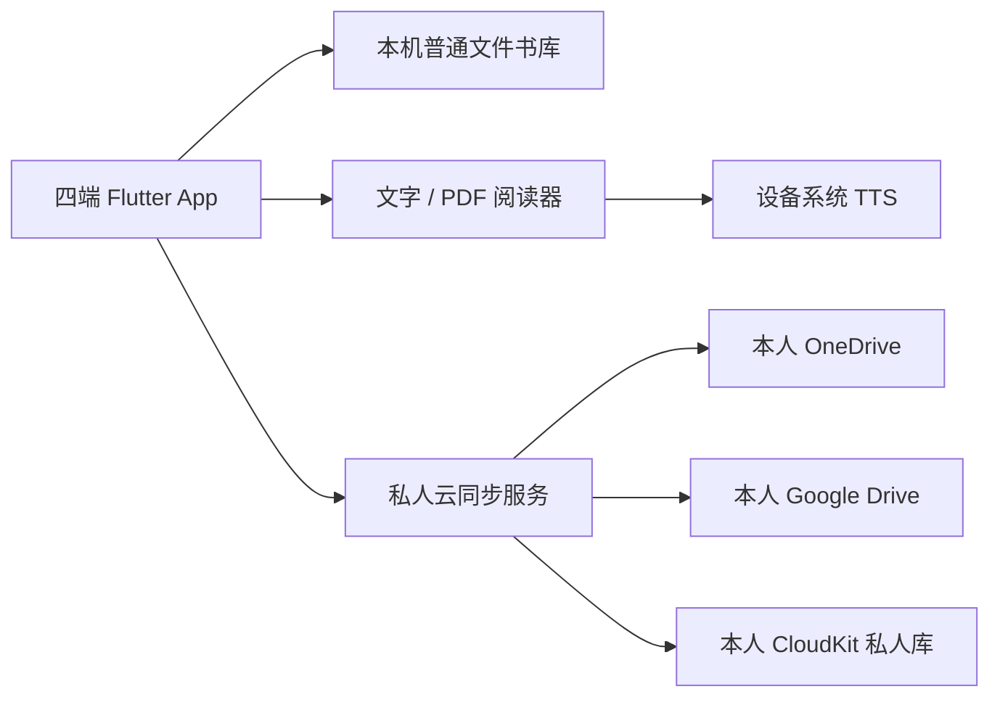

# BookWorm／书虫：第一阶段系统设计

版本：0.3 · 2026-11-14
用户已授权第一阶段实施；商业远景见 [历史系统设计](system-design-v0.2.md)。

## 架构

不使用书虫内容服务器，不做加密书籍容器。系统安全存储只保护云访问凭据，不改变书籍普通文件保存要求。

## 当前模块

| 模块 | 文件与职责 |
| --- | --- |
| 书籍模型 | `lib/models/local_book.dart`：小节、正文、文件指纹、位置及修改时间 |
| 文件仓库 | `lib/storage/local_library.dart`：每书 JSON 与原件 `.source`、串行写入、临时替换与备份、旧数据迁移 |
| 文件解析 | `lib/importing/book_importer.dart`：UTF-8 TXT、有界文字小节、EPUB spine 正文、PDF 页面文本 |
| 朗读控制 | `lib/audio/reading_player.dart`：可替换语音引擎、短段队列、字符进度、取消代次、定时 |
| 云协议 | `lib/cloud/cloud_provider.dart`：连接、断开、列举、读取与写入对象 |
| 云授权 | `lib/cloud/oauth_session.dart`：Microsoft／Google 用户授权、PKCE、原生 Google 登录、令牌刷新与安全保存 |
| 云连接 | `drive_providers.dart`、`icloud_provider.dart`：各云 HTTP API；iCloud 仅 `private` 路径 |
| 同步引擎 | `lib/cloud/library_sync.dart`：分块、校验、最后提交清单、本机进度文件、远端位置候选 |
| 界面 | `lib/main.dart`、`lib/screens/reader_screen.dart`：书架、听书、私人云、目录、检索、阅读与播放设置 |

## 文件与故障处理

每书文件 ID 为原始 bytes 的 SHA-256；JSON 保存解析内容及小节／字符位置，`.source` 保存普通原件副本。文件放应用支持目录，不拼接不可信书名作为路径。写入排队、临时文件 flush 后替换，保留中断恢复备份；异常书文件不静默删除。

旧原型的整书 SharedPreferences 数据一次性迁移，保留旧数据与旧笔记。第一阶段不引入 SQLite 或加密数据库，不扩大存储系统复杂度。

PDF 通过内存源打开原版，文字层用于 TTS；没有文本层的页面保留原版阅读。EPUB 本轮只渲染文字和标题，不执行脚本、不加载外网资源，不冒充保留完整 CSS 和插图。

## TTS 与位置

系统 TTS 每段约 180 字符，优先句子边界；段完成保存，支持系统字符进度时更新当前位置。暂停用 stop 与保存的字符位置恢复，使用 generation 防止旧完成回调把新会话推进。无法提供逐字回调的平台至少按短段定位，需真机确认差异。

阅读和听书共享 `section + offset`。阅读选中文字设起点；PDF 页变化设对应文本页起点。每 5 秒及退出时保存位置。定时由播放控制器持有，不绑定设置弹窗。

iOS 配置 playback audio session 与音频后台声明。Android 持久前台媒体服务／通知和各端锁屏媒体控制仍须独立实现验证，不能从短段 TTS 推定后台全功能成立。

## 云文件协议

- 内容：`book-{hash}-{index}.part`，每块 192 KiB；各块有 SHA-256、长度。
- 提交：`book-{hash}.manifest` 最后写入，引用完整分块清单。
- 包内容：书籍模型（初始位置归零）与原件 base64；整包普通 JSON，没有应用加密。
- 进度：`position-{hash}-{device}.json`；设备 ID 本机随机生成，各设备只更新自己文件。
- 接收端检查 key、ID、hash、长度和总量上限，只有完整验证后写入原件与书架记录。
- 云位置和本机不同时作为候选，用户选择续接，不依据不可信时钟静默覆盖。

本阶段的冲突处理保留人工选择，不声称实现完整 CRDT。云重名、最终一致、上传中断及 API 限流需持续真实测试。删除本机不删除云，无云端删除传播或自动跨云镜像。

## 三种连接器

OneDrive：Microsoft Graph delegated `Files.ReadWrite.AppFolder`，本人 app root，系统浏览器用户授权＋PKCE。桌面循环回调与移动端 URL scheme 分别配置。

Google Drive：`drive.appdata` 与本人 `appDataFolder`，移动／苹果桌面使用原生 Google 授权，Windows 用桌面 OAuth；同一 Google Cloud 项目配置对应端 client IDs。分页列举、媒体下载、resumable session 上传。需验证令牌更新、组织策略及 Google 平台授权约束。

iCloud：CloudKit Web Services 用户 Web Auth Token，只调用 private database。使用 `BookWormObject` 记录，`key` 和 base64 `data` 字段；192 KiB 数据块避免单条大型书籍记录。需要真实 container、API token、生产 schema、查询索引与回调配置；与 iCloud Drive 可见文件夹不同，不混用路径。四端 browser 授权与 token 生命周期尚须实测。

文档依据：[OneDrive 应用目录](https://learn.microsoft.com/en-us/graph/onedrive-sharepoint-appfolder)、[Google 应用数据目录](https://developers.google.com/workspace/drive/api/guides/appdata)、[CloudKit 用户授权](https://developer.apple.com/library/archive/documentation/DataManagement/Conceptual/CloudKitWebServicesReference/SettingUpWebServices.html)。这些资料支持 API 设计，不代表本项目已完成账户注册或四端登录验证。

## 配置与验收

见 [云配置](cloud-setup.md)。无有效开发者应用配置时，界面明确显示“当前构建未配置登录”，不展示假登录或模拟成功。

先完成本地与模拟云测试，再分别验证三种云 × 四端；构建、真机与真实授权结果写入 PROGRESS.md。未配置的外部账号不通过伪造 client ID 或上传平台中转绕过。
